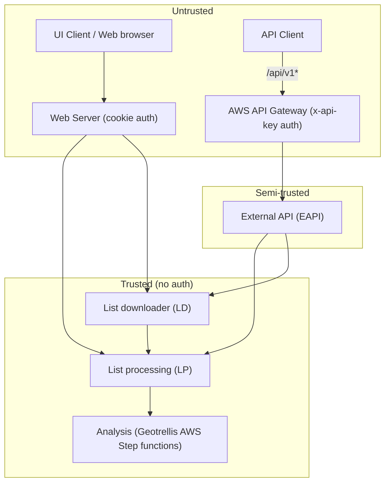
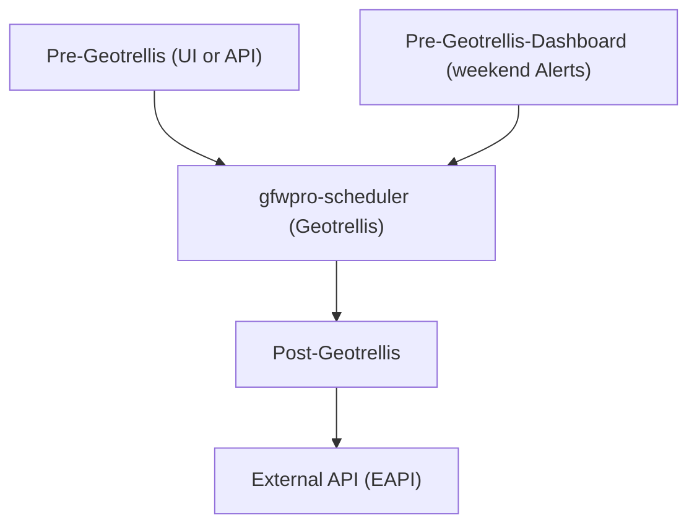

## GFW-PRO Microservices

This is a monorepo project that contains the web client (apps/webserver/client),
web server (apps/webserver/server), and the three `GFW-PRO` microservices:
EAPI (apps/microservices/externalapi),
LP (apps/microservices/list-processing),
and LD (apps/microservices/list-downloader).

### Overall high-level architecture diagram



Each of the 3 microservices (EAPI, LP, LD) and the webserver also communicate with a SQL DB
(running on an EC2 instance). DB schema for tables associated with lists is documented at
https://gfw.atlassian.net/wiki/spaces/GPS/pages/1888944174/Database+schema+for+lists

For more information on connections between services, see
https://github.com/wri/gfwpro-infrastructure/blob/develop/README.md.

There are three deployed environments on AWS (QA, staging, and production), with all the above
mentioned pieces. The fourth environment (development) only has SQL DB and AWS Step functions
deployed, but the other parts are run from local development environment.

#### List analysis diagram



### Install

First, we have to install and use node version `24.16.0`

Second you have to install the `nx` as global:

```sh
npm install -g nx
```

Install all dependencies needed for the project:

```sh
npm install --legacy-peer-deps
```

---

**NOTE**

we use Husky to automatically run format, lint and test , but to install it you must run `npm install --legacy-peer-deps` at least once. Thus, lint-staged will see what is being changed and run the steps on top of them.

---

#### Pre-requisites for webserver

##### Docker Command to Build/Run

Docker is used to run a redis container for development builds

```sh
docker-compose -f docker-compose.website.dev.yml build
docker-compose -f docker-compose.website.dev.yml up -d
```

You will need to set REDIS_HOST value in the .env file to point to the localhost or
another host if your redis confguration requires a different IP address.

```sh
REDIS_HOST=127.0.0.1
```

##### Tippecanoe

Tippecanoe is a software package that is used to generate mapbox vector tiles for lists.
To install on MacOS, use the brew.

```sh
brew install tippecanoe
```

To install on Ubuntu, use the following commands

```sh
sudo apt-get update
sudo apt-get install git build-essential libsqlite3-dev zlib1g-dev
mkdir -p /tmp/tippecanoe-src
git clone https://github.com/mapbox/tippecanoe.git /tmp/tippecanoe-src
cd /tmp/tippecanoe-src
make
sudo make install
rm -rf /tmp/tippecanoe-src
```

After installation tippecanoe must be in your path.
NOTE: You may need to start a new terminal window to see the affect of the installtion.
To check you can run the following command

```sh
which tippecanoe
```

That should print out the full path to the tippecanoe binary. If it prints nothing, or an
error message, the installtion didn't work right.

You can also run the tippecanoe command without any paramaters

```sh
tippecanoe
```

It should run the tippecanoe binary and print an error message like the following

```sh
tippecanoe: must specify -o out.mbtiles or -e directory
```

### Run

Before running the microservices, you have to create a `.env` file inside the root of the project.

Inside each microservice app there is an `example.env` file where you can find `ENVIRONMENT VARIABLE`s needed for that app.

If you consider having one .env is more convenient, here is a simple command to gather all the example.env files and create the .env file at the root of the repo:

```sh
cat apps/*/*/*.env | sort | uniq > .env
```

Here is the loading order of environment files: https://nx.dev/recipes/environment-variables/define-environment-variables

#### Webserver

Once everything is setup, run the webserver with the following command.
This will start the typescript compilation for the backend, run the backend, start webpack build
for the frontend, and serve it up on default 8443 port. This command also watches the filesystem
for changes to any code files and will automatically rebuild and re-serve the webserver.

```sh
nx serve webserver
```

#### List-Downloader

The following command runs the downloader microservice; this microservice has the logic to create CSVs or Shapefiles using the data stored inside the database.

```sh
nx serve microservices-list-downloader
```

> Check the environment variable `AWS_TMP_QUEUE=` inside gfw-microservices **.secret** and microservices **.env** are pointing to the same queue.

#### External API

The following command runs the externalapi microservice; it allows organizations to interact with Pro using APIs.

```sh
nx serve microservices-externalapi
```

#### List-Processing

The following command runs the list-processing microservice; it allows users to upload large lists and execute copy/move operations.

```sh
nx serve microservices-list-processing
```

> Check the environment variable `LISTS_MICROSERVICE_URL=` inside the **.secret** file in the `gfw-microservices` project. Make sure it is pointing to the right IP address.

```sh
LISTS_MICROSERVICE_URL=http://192.168.5.147:3333/api
```

or

```sh
LISTS_MICROSERVICE_URL=http://host.docker.internal:3333/api
```

> recommend that you connect to the special DNS name `host.docker.internal` which resolves to the internal IP address used by the host

### Webserver

> This project contains our front-end and back-end

### Test

To run tests for a microservice, just specify the name of the microservice:

```sh
nx test microservices-list-downloader
```

### Format

If you want to run `prettier` to format the code, you can use the following command to specify the name of the microservice.

```sh
nx format microservices-list-downloader
```

### Lint

If you want to run `lint`, you can use the following command;

```sh
nx lint microservices-list-downloader
```

### Repository Directory Structure

```sh
.
├── .aws/              # AWS ECS task definitions for webserver and microservices
├── .github/
│   └── workflows/     # Github actions definitions
├── .husky/            # Checks for git commit
├── apps/              # contains the application projects.
│   ├── gfwpro-e2e/    # Cypress e2e tests for gfwpro (requires webserver and microservices to run)
│   ├── webserver/     # gfwpro project contains our front-end and back-end
│   └── microservices/
│       ├── externalapi/     # External API (EAPI) microservice
│       ├── externalapi-e2e/ # EAPI e2e tests (requires EAPI, LP, and LD microservices)
│       ├── list-downloader/ # list downloader (LD) microservice
│       └── list-processing/ # list processing (LP) microservice
├── libs/           # contains the library projects (included by webserver and microservices)
│   ├── aws/        # how to connect to AWS
│   ├── constants/  # defines various constants
│   ├── geo/        # geo processing functions
│   ├── shared/     # code that don't have a logic group.
│   └── sql/        # connect to the database, typeORM entity definitions, SQL scripts, and some Stored Procedures.
├── test_files/
├── tools/                    # contains scripts that act on your code base.
│   ├── db_to_s3_for_athena/  # SQL srcripts run on prod DB used to populate Athena tables
├── .editorconfig  # file to standardize our IDE
├── .eslintrc.json # lint configuration file
├── jest.config.ts # jest configuration file
├── jest.preset.js # used to set stuff before running tests
├── nx.json   # configures the Nx CLI itself
├── package.json # store the libraries needed for the project
├── README.md
├── tsconfig.base.json # sets up the global TypeScript settings and creates aliases for each library to aid
└── workspace.json # has the path of all shared libraries and project
```

### Map Layers

Currently the datasets and layers definitions used by GFW Pro Map are stored in
webserver/src/client/common/js/service/mapLayers.constants.js

### Commit Lint

Our project forces you to use the following pattern to commit on our project:

> type(scope): subject

- **type** according to build commitlint conventions, we have the following types:
  - `chore`
  - `ci`
  - `docs`
  - `feat`
  - `fix`
  - `perf`
  - `refactor`
  - `revert`
  - `style`
  - `test`
- **scope** is our nx modules like: `
  - `geo`
  - `microservices-list-downloader`
  - `microservices-list-processing`
  - `shared`
  - `sql`
- **subject** the message that you want to pass with your commit.

### NX Basic Commands

#### Generate an application

Run nx g @nrwl/nest:app my-app to generate an application.

> When using Nx, you can create multiple applications and libraries in the same workspace.

#### Generate a library

Run nx g @nrwl/nest:lib my-lib to generate a library.

> Libraries are shareable across libraries and applications. They can be imported from @wri-monorepos/mylib.

#### Development server

Run `nx serve my-app` for a dev server. Navigate to http://localhost:3333/. The app will automatically reload if you change any of the source files.

### Debugging in VS Code

- To debug `Webserver` you need to copy `websocketAddress` value from terminal and paste in on launch.json.
- For Microservices though, you don't need `websocketAddress`. You just need to have the `.env` file in the root of the microservice you want to debug.
