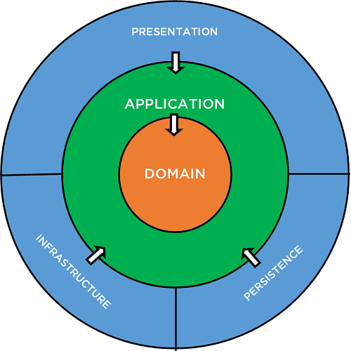

# Clean Architecture for B2B Microservice

This document provides an overview of the Clean Architecture implemented for the "b2b" microservice using NestJS and TypeScript. The architecture consists of three layers: application, domain, and infrastructure. Additionally, the code is organized into units of business (Invitation, Connection) and there is a "shared" folder where is contain all the logic that needs to be required from the units of business.

## Application Layer

The application layer is responsible for the use cases and business logic of the microservice. It contains the application services that orchestrate the interaction between the domain and infrastructure layers. The application layer is independent of the framework or infrastructure and can be easily replaced or tested.

## Domain Layer

The domain layer contains the business logic of the microservice. It is where the entities, value objects, and business rules are defined. The domain layer is independent of the infrastructure and application layers.

## Infrastructure Layer

The infrastructure layer contains the implementation details of the microservice, such as databases, external APIs, and other infrastructure-related concerns. It is responsible for interacting with the outside world and providing concrete implementations for the application and domain layers.

## Shared Layer

The shared layer contains general things that are called from the other units of business, such as common utilities, configurations, and constants.

## Description Search Endpoints

This endpoint allows you to search a database using filters and sorting.

## Input parameters

The following parameters are required to perform a search:

- `filters`: an array of objects that contain the filters for the search. Each object must have the following properties:

  - `field`: specifies the field in the database that you want to filter on.
  - `operator`: specifies the operator that will be used to filter the results. The available operators are: `=`, `!=`, `>`, `<`, `CONTAINS`, and `NOT_CONTAINS`.
  - `value`: specifies the value that will be used to filter the results.

- `orders`: an array of objects that contains the sorting criteria for the search results. Each object must have the following properties:

  - `by`: specifies the field by which you want to sort the results.
  - `type`: specifies the type of sorting, which can be `asc` (ascending) or `desc` (descending).

- `limit`: specifies the maximum number of results you want to get.
- `offset`: specifies the number of results you want to skip before starting to get the results.

## Example usage

Suppose you want to search the conection database, filtering by id `10`, sorting first by creation date in ascending order and then by `idSourceOrganization` in ascending order, and getting only the first 20 results.

The API call could look something like this:

cssCopy code

`GET /search?filters[0][field]=id&filters[0][operator]=&filters[0][value]=10&orders[0][by]=createDate&orders[0][type]=asc&orders[1][by]=idSourceOrganization&orders[1][type]=asc&limit=20&offset=0`

## Example of Pagination

Suppose you have a total of 112 results and you want to retrieve the results in pages of 20 items each. To get the first page of results, you could use the following API call:

`GET /search?filters[0][field]=id&filters[0][operator]=&filters[0][value]=10&orders[0][by]=createDate&orders[0][type]=asc&orders[1][by]=idSourceOrganization&orders[1][type]=asc&limit=20&offset=0`

The response will be the first 20 results, with a `count` of 112, `offset` of 0, and `limit` of 20.

To get the second page of results, you could use the following API call:

`GET /search?filters[0][field]=id&filters[0][operator]=&filters[0][value]=10&orders[0][by]=createDate&orders[0][type]=asc&orders[1][by]=idSourceOrganization&orders[1][type]=asc&limit=20&offset=20`

This time, the response will be the next 20 results, with a `count` of 112, `offset` of 20, and `limit` of 20.

You can keep doing this until you retrieve all the results.

## Javascript Example of Pagination

    // assume we have received the following response from the API:

    const response = {
    "count": 112,
    "offset": 0,
    "limit": 20,
    "items": [ ... ]
    };

    // calculate the number of pages based on the limit and count:
    const pageCount = Math.ceil(response.count / response.limit);

    // to navigate to a specific page, update the offset:
    const pageIndex = 3;
    const offset = pageIndex * response.limit;
